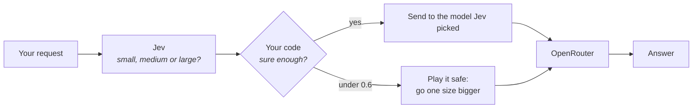

# 4. Build a model router

The router from the video. Every AI request doesn't need the biggest, most expensive model. "What's 2+2?" doesn't need Claude. Jev reads each request, answers one multiple-choice question (small, medium or large model?), and the request goes to the winner.

[◀ Previous: let your coding agent do it](03-coding-agent.md) · [Back to the guide](../README.md) · [Next: what people are building ▶](05-what-people-built.md)

---

## How it works



The question Jev gets is a **choice** with three options, each described in plain words:

```json
{
  "route": {
    "type": "choice",
    "instructions": "Which size of AI model does this request need to be answered correctly?",
    "criteria": {
      "small": "Trivial: arithmetic, short facts, greetings, one-line rewrites",
      "medium": "Everyday: explanations, summaries, short creative writing, simple code",
      "large": "Hard: math proofs, multi-step reasoning, finding and fixing bugs in code, long or subtle analysis"
    }
  }
}
```

Notice where the rules live. Jev makes the judgment call. **Your code** decides what to do when Jev isn't sure (here: under 0.6, move up one size) and which real model each size means.

| Size | Model (through OpenRouter) |
|---|---|
| small | `openai/gpt-6-luna` |
| medium | `google/gemini-3.6-flash` |
| large | `anthropic/claude-sonnet-5` |

Swap in any models you like at the top of [`router.ts`](../examples/router/router.ts).

## Step 1. Install Bun

The router is one TypeScript file that runs on [Bun](https://bun.sh). If you don't have it:

```bash
curl -fsSL https://bun.sh/install | bash
```

Then open a new terminal so the `bun` command is found.

## Step 2. Set your keys

You need the TypeSafe key from chapter 2:

```bash
export TYPESAFE_API_KEY="paste-your-key-here"
```

For the full router, where the chosen model actually answers, you also need an [OpenRouter](https://openrouter.ai) key with a little credit:

```bash
export OPENROUTER_API_KEY="paste-your-openrouter-key-here"
```

No OpenRouter key? Skip it and use `--decide-only` below. You'll still see every decision Jev makes.

## Step 3. Watch Jev decide

From the top of this repo:

```bash
cd examples/router
bun router.ts --decide-only
```

It runs five demo requests. Here's what our run looked like (yours will be close, not identical):

```
━━━ What's 2+2?
Jev decided in 170 ms for $0.0000159:
  small  ████████████████████ 1.00  ◀ PICKED
  medium ···················· 0.00
  large  ···················· 0.00
→ sending to small: openai/gpt-6-luna

━━━ Write a haiku about coffee.
Jev decided in 110 ms for $0.0000159:
  small  ███················· 0.15
  medium █████████████████··· 0.85  ◀ PICKED
  large  ···················· 0.00
→ sending to medium: google/gemini-3.6-flash

━━━ Prove there are infinitely many primes.
Jev decided in 112 ms for $0.0000159:
  small  ███················· 0.17
  medium █··················· 0.07
  large  ███████████████····· 0.76  ◀ PICKED
→ sending to large: anthropic/claude-sonnet-5
```

Each decision takes about a tenth of a second and costs a tiny fraction of a cent. That's the whole point: you don't want a big model sitting there thinking "is this a hard question?" before it even starts.

## Step 4. Run the full router

With your OpenRouter key set, drop `--decide-only`:

```bash
bun router.ts
```

Now each request goes on to the model Jev picked, and you see the answer, how long it took and what it cost. For "What's 2+2?" our run picked the small model, which answered `4` in 1.5 seconds for less than a thousandth of a cent.

## Step 5. Try your own requests

```bash
bun router.ts "Explain how DNS works to a 10 year old"
bun router.ts --decide-only "Write a Python script that renames every photo in a folder by the date it was taken"
```

If Jev's top pick comes back under 0.6, the router prints `Jev is only ... sure` and moves up one size. That 0.6 line is our demo rule, not a TypeSafe number. Change `SURE_ENOUGH` in `router.ts` to make it braver or more careful.

## Ideas to take it further

- Change the three descriptions in `criteria` to match the kind of requests you actually send.
- Add a fourth size, like `"local"` for a model running on your own machine.
- Log every decision for a week, then check whether the small model was really good enough.

## Rather not build it yourself?

OpenRouter now offers a Jev-powered router as a product: the model ID `typesafe/jev-router` on [openrouter.ai](https://openrouter.ai). This chapter shows you what's going on inside one.

[◀ Previous: let your coding agent do it](03-coding-agent.md) · [Back to the guide](../README.md) · [Next: what people are building ▶](05-what-people-built.md)
